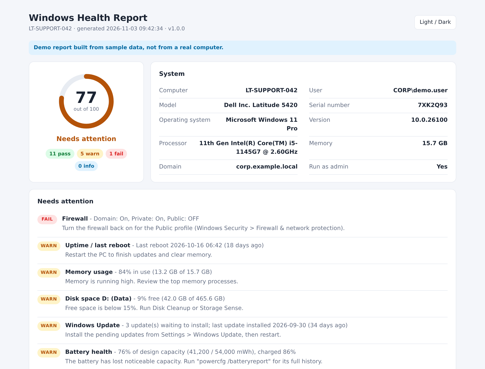
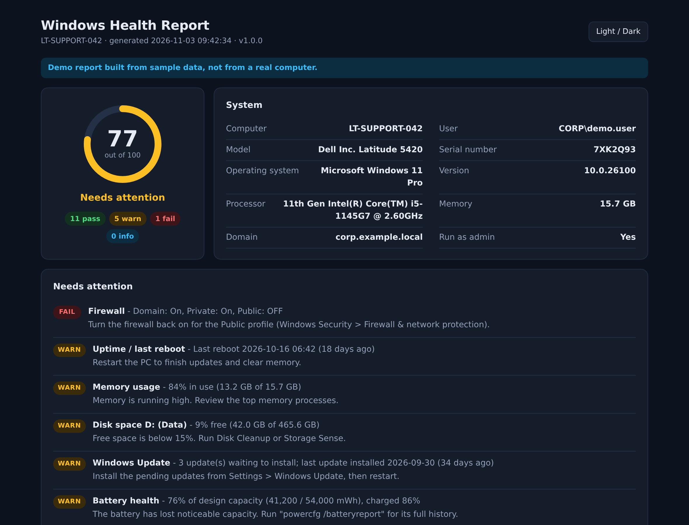
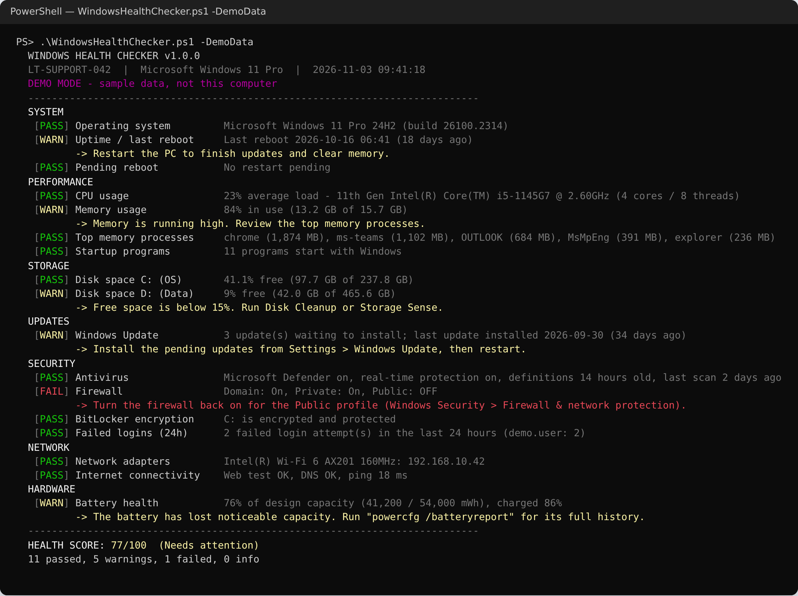

# Windows Health Checker


A PowerShell script that checks the health of a Windows 10/11 PC in about a minute and produces a clear report: a coloured console summary, a self-contained HTML report with a score out of 100, and optional JSON for ticketing or RMM tools.

It is built for IT support work: run it on a user's PC when they say "my computer is slow" or before handing over a laptop, and you get one page that shows what is wrong and what to do about it.

The script is **read-only**. It changes nothing on the computer and does not need administrator rights.



<details>
<summary>Dark theme and full report</summary>



Full page: [docs/report-dark-full.png](docs/report-dark-full.png) &middot; Open the sample: [sample-report.html](sample-report.html)

</details>

## Why

Most first-line tickets start with the same questions: Is the disk full? When did it last restart? Is the antivirus up to date? Are updates pending? Is the firewall on? Answering them by hand means clicking through Settings, Task Manager, Windows Security and `ipconfig`. This script answers all of them at once, scores the result, and leaves a report you can attach to the ticket.

## Features

| Area | Check | PASS / WARN / FAIL rule (defaults) |
|---|---|---|
| System | OS version and build | WARN on Windows 10 (end of support 14 Oct 2025) or an older Windows 11 feature update; FAIL on Windows 7/8 |
| System | Uptime / last reboot | WARN after 14 days, FAIL after 30 |
| System | Pending reboot | WARN if Windows Update, servicing or file operations need a restart |
| Performance | CPU usage | Average of 3 samples. WARN at 75%, FAIL at 90% |
| Performance | Memory usage | WARN at 80% used, FAIL at 90% |
| Performance | Top 5 memory processes | WARN if one process uses more than 25% of RAM |
| Performance | Startup programs | WARN above 15 |
| Storage | Free space per fixed drive | WARN below 15% free, FAIL below 5% |
| Updates | Windows Update | Pending updates (WARN) and days since the last installed update (WARN after 45, FAIL after 60) |
| Security | Antivirus | Defender real-time protection, definitions age (WARN > 3 days, FAIL > 7), last scan (WARN > 14 days). Third-party antivirus is detected through Security Center |
| Security | Firewall | FAIL if any profile (Domain, Private, Public) is off |
| Security | BitLocker | PASS if the system drive is protected; WARN if suspended or off; FAIL if off on a laptop |
| Security | Failed logins (24h) | Event 4625. WARN at 5, FAIL at 20. Needs admin rights, otherwise INFO |
| Network | Adapters, IP, gateway, DNS | FAIL with no valid IP; WARN on a 169.254.x.x address or missing DNS |
| Network | Internet | Web test, DNS lookup and ping. WARN on partial access or latency over 150 ms |
| Hardware | Battery health | Full charge vs design capacity. WARN below 80%, FAIL below 60%. INFO on desktops |

**INFO** means "not applicable or could not be read" (for example, no battery, or a check that needs admin rights). INFO results are shown but not scored.

All thresholds and score weights are in one block at the top of the script, so they can be changed to match company policy.

## Quick start

**Option 1: double-click**

Download or clone the repo, then double-click `Run-HealthCheck.cmd`. The report is saved to the Desktop and opens in the browser.

**Option 2: PowerShell**

```powershell
powershell -ExecutionPolicy Bypass -File .\src\WindowsHealthChecker.ps1
```

If Windows blocks the file because it was downloaded, run `Unblock-File .\src\WindowsHealthChecker.ps1` once.

### Parameters

| Parameter | Description |
|---|---|
| `-OutputPath <folder>` | Where to save reports. Default: Desktop |
| `-Json` | Also save a JSON file |
| `-NoHtml` | Do not save the HTML report |
| `-Quiet` | No console output (for scheduled tasks and RMM tools) |
| `-SkipUpdateCheck` | Skip the online Windows Update search (it can take up to a minute) |
| `-OpenReport` | Open the HTML report when finished |
| `-PassThru` | Return the report object to the pipeline |
| `-DemoData` | Build the report from sample data. Works on any OS, useful for trying it out |

### Examples

```powershell
# Full check, open the report
.\src\WindowsHealthChecker.ps1 -OpenReport

# Silent run that saves JSON to a share, e.g. from a scheduled task
.\src\WindowsHealthChecker.ps1 -Quiet -NoHtml -Json -OutputPath \\fileserver\it\health

# Use the results in another script
$report = .\src\WindowsHealthChecker.ps1 -Quiet -NoHtml -PassThru
$report.Results | Where-Object Status -eq 'FAIL'
```

### Exit codes

| Code | Meaning |
|---|---|
| 0 | All scored checks passed |
| 1 | At least one WARN |
| 2 | At least one FAIL |
| 3 | Not running on Windows (and `-DemoData` not used) |

## Sample output

Console (from `-DemoData`):



<details>
<summary>Console output as text</summary>

```text
  WINDOWS HEALTH CHECKER v1.0.0
  LT-SUPPORT-042  |  Microsoft Windows 11 Pro  |  2026-11-03 09:41:18
  DEMO MODE - sample data, not this computer
  ----------------------------------------------------------------------------
  SYSTEM
   [PASS] Operating system         Microsoft Windows 11 Pro 24H2 (build 26100.2314)
   [WARN] Uptime / last reboot     Last reboot 2026-10-16 06:41 (18 days ago)
          -> Restart the PC to finish updates and clear memory.
   [PASS] Pending reboot           No restart pending
  PERFORMANCE
   [PASS] CPU usage                23% average load - 11th Gen Intel(R) Core(TM) i5-1145G7 @ 2.60GHz (4 cores / 8 threads)
   [WARN] Memory usage             84% in use (13.2 GB of 15.7 GB)
          -> Memory is running high. Review the top memory processes.
   [PASS] Top memory processes     chrome (1,874 MB), ms-teams (1,102 MB), OUTLOOK (684 MB), MsMpEng (391 MB), explorer (236 MB)
   [PASS] Startup programs         11 programs start with Windows
  STORAGE
   [PASS] Disk space C: (OS)       41.1% free (97.7 GB of 237.8 GB)
   [WARN] Disk space D: (Data)     9% free (42.0 GB of 465.6 GB)
          -> Free space is below 15%. Run Disk Cleanup or Storage Sense.
  UPDATES
   [WARN] Windows Update           3 update(s) waiting to install; last update installed 2026-09-30 (34 days ago)
          -> Install the pending updates from Settings > Windows Update, then restart.
  SECURITY
   [PASS] Antivirus                Microsoft Defender on, real-time protection on, definitions 14 hours old, last scan 2 days ago
   [FAIL] Firewall                 Domain: On, Private: On, Public: OFF
          -> Turn the firewall back on for the Public profile (Windows Security > Firewall & network protection).
   [PASS] BitLocker encryption     C: is encrypted and protected
   [PASS] Failed logins (24h)      2 failed login attempt(s) in the last 24 hours (demo.user: 2)
  NETWORK
   [PASS] Network adapters         Intel(R) Wi-Fi 6 AX201 160MHz: 192.168.10.42
   [PASS] Internet connectivity    Web test OK, DNS OK, ping 18 ms
  HARDWARE
   [WARN] Battery health           76% of design capacity (41,200 / 54,000 mWh), charged 86%
          -> The battery has lost noticeable capacity. Run "powercfg /batteryreport" for its full history.
  ----------------------------------------------------------------------------
  HEALTH SCORE: 77/100  (Needs attention)
  11 passed, 5 warnings, 1 failed, 0 info
```

</details>

JSON (`-Json`, shortened):

```json

```

## How it works

```
Get-Whc*Data      reads the system (CIM/WMI, registry, Defender, event log, .NET)
      |
Test-Whc*         turns that data into PASS / WARN / FAIL / INFO + reason + recommendation
      |
Get-WhcScore      weighted score out of 100
      |
Console / HTML / JSON output
```

- **Collection and evaluation are separate.** Each check has a function that only reads data and a second function that only decides the status. The decision logic can therefore be tested with mock data, without Windows.
- **One failing check never stops the report.** Each check runs inside its own `try/catch`. If something breaks (for example a damaged WMI repository), that check shows as INFO with the error message and the rest of the report continues.
- **No admin needed.** Where a source needs elevation, the script uses a fallback: BitLocker state comes from the Explorer shell property when `Get-BitLockerVolume` is not allowed, firewall state from `netsh` if the NetSecurity module is missing, and the failed-login check reports INFO instead of failing.
- **Slow sources are time-boxed.** The Windows Update search runs in a background job with a 90-second timeout.
- **Scoring.** Each check has a weight (antivirus 15, Windows Update 14, firewall 10, BitLocker 8, ...). PASS earns the full weight, WARN half, FAIL nothing. 90+ is "Healthy", 70-89 "Needs attention", below 70 "At risk".
- **Compatible with Windows PowerShell 5.1 and PowerShell 7.** The script is plain ASCII (5.1 reads files without a BOM as ANSI), avoids 7-only syntax, and uses .NET classes for ping, DNS and HTTP so behaviour is the same on both. The HTML report has no external files, fonts or scripts, so it can be emailed or attached to a ticket.

## Tests

The Pester suite (77 tests) covers every evaluation rule, the scoring, HTML encoding, JSON output, file saving, error isolation, and the collectors with Windows cmdlets mocked (`Get-CimInstance`, `Get-MpComputerStatus`, `Get-NetFirewallProfile`, `Get-WinEvent`). Because the Windows-only commands are mocked, the suite also runs on Linux and macOS with PowerShell 7.

```powershell
Install-Module Pester -MinimumVersion 5.5.0 -Scope CurrentUser -Force -SkipPublisherCheck
Invoke-Pester -Path .\tests -Output Detailed
```

The script is also checked with PSScriptAnalyzer, including its compatibility rules for Windows PowerShell 5.1 and PowerShell 7. A GitHub Actions workflow (`.github/workflows/tests.yml`) runs the linter and tests on a Windows runner under both shells and saves a real report from the runner as a build artifact.

## Project structure

```
windows-health-checker/
|-- src/
|   `-- WindowsHealthChecker.ps1    the tool (single file)
|-- tests/
|   `-- WindowsHealthChecker.Tests.ps1
|-- docs/                           screenshots
|-- .github/workflows/tests.yml     CI on Windows (PowerShell 5.1 and 7)
|-- Run-HealthCheck.cmd             double-click launcher
|-- sample-report.html              report generated with -DemoData
|-- CHANGELOG.md
`-- LICENSE
```

## Limitations

- Battery capacity and failed-login counts may need admin rights on some PCs; they show as INFO when they cannot be read.
- The `netsh` firewall fallback only parses English output. The main method (`Get-NetFirewallProfile`) is language-independent.
- The minimum "current" Windows 11 build is a setting (`MinWindows11Build`, currently 24H2). It needs updating as Microsoft's support dates move.
- The Windows Update search needs access to Windows Update or the company WSUS server.
- CPU usage is a short sample taken while the script runs, not a long-term average.

## Roadmap

- [ ] Physical disk health (SMART / `Get-PhysicalDisk` health status)
- [ ] Critical and error events from the System log in the last 24 hours
- [ ] Windows activation and licence status
- [ ] Run against remote PCs with `Invoke-Command` and combine results into one report
- [ ] CSV export for checking many PCs at once
- [ ] Optional email or Microsoft Teams notification when the score drops below a threshold

## Author

**Nived NS** - IT Support Executive

- LinkedIn: [linkedin.com/in/your-profile](https://www.linkedin.com/in/your-profile)
- GitHub: [@connectnived-lab](https://github.com/connectnived-lab)

## License

MIT - see [LICENSE](LICENSE).
